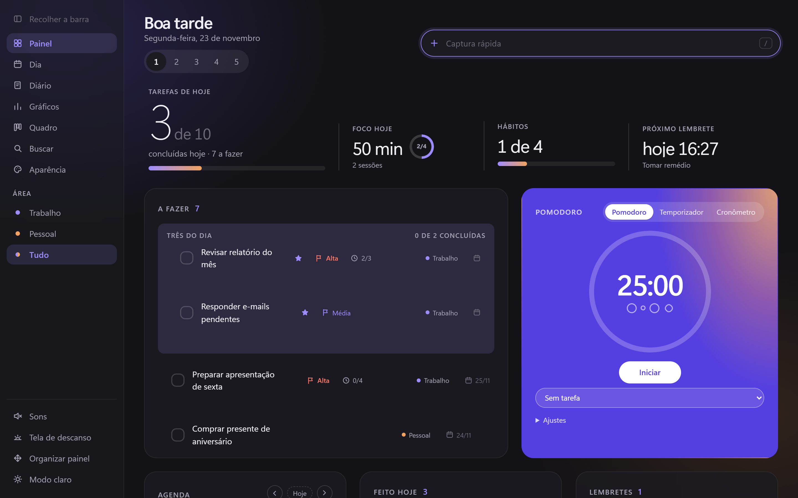
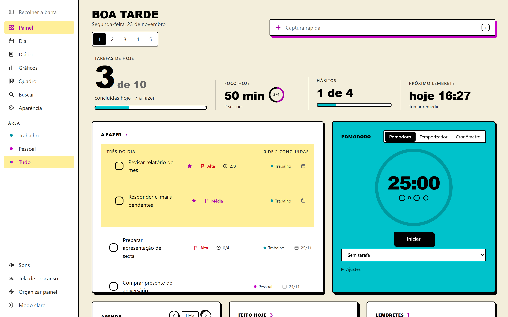
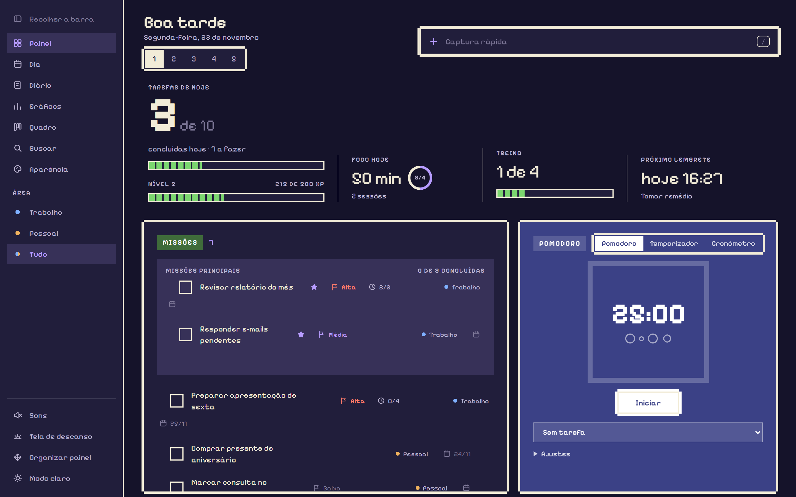
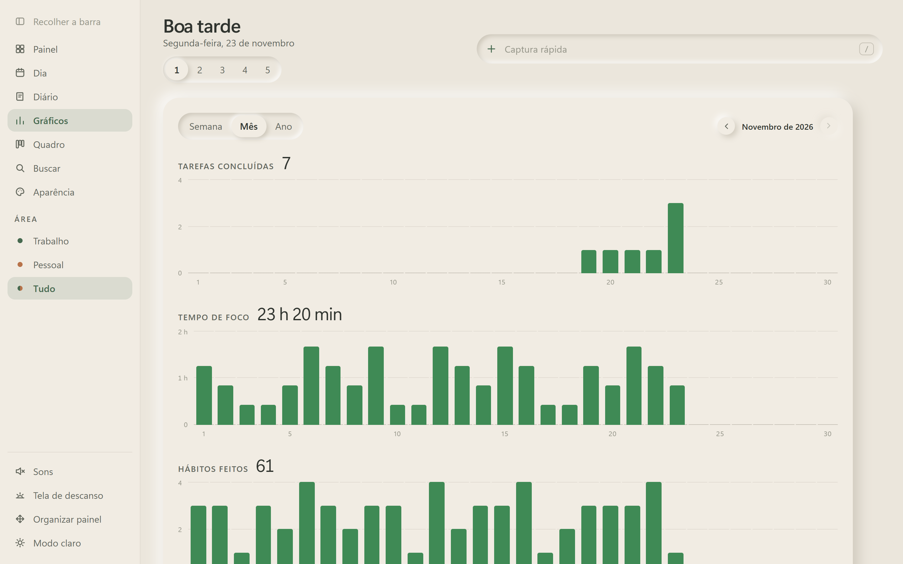
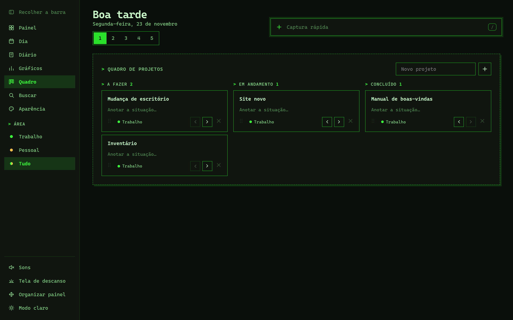

# Recanto

Painel pessoal que abre em toda nova aba do Chrome ou do Edge. Junta tarefas, pomodoro, agenda, hábitos, diário e gráficos numa página só, com 17 temas. Funciona sem internet, e os dados ficam só no seu navegador.

## O que tem

- **Tarefas**: captura rápida, prioridade, "três do dia", tarefas repetidas, "aguardando alguém" e áreas Trabalho e Pessoal.
- **Relógio**: pomodoro, temporizador e cronômetro, com modo foco em tela cheia e meta de focos do dia.
- **Agenda e lembretes**: blocos do dia com aviso no meio da tela, calendário do mês e lembretes avulsos.
- **Hábitos, metas e diário**: grade da semana com sequência, metas com contador e uma página de diário por dia.
- **Gráficos**: tarefas, foco e hábitos por semana, mês e ano, mapa de calor e um resumo em texto para copiar.
- **Quadro de projetos**: colunas A fazer, Em andamento e Concluído.
- **Painel que você monta**: arraste os cartões pelo título e estique pelas bordas. São cinco arranjos, trocados pelas teclas 1 a 5.
- **Temas**: 17 temas, cada um com modo claro e escuro. O tema pode mudar sozinho pela hora do dia ou num revezamento.
- **Spotify**: com o Spotify aberto numa aba, a música atual aparece no topo, com a anterior, a próxima e os controles.
- **Sons de fundo**: chuva, café, lareira etc., com os seus próprios arquivos de áudio (veja `painel/sons/LEIA.md`).

| Brutal (claro) | Pixel (escuro) |
| --- | --- |
|  |  |
| **Gráficos (tema Calma)** | **Quadro (tema Terminal)** |
|  |  |

## Instalar

1. Baixe o `.zip` da [última versão](../../releases/latest) e descompacte numa pasta que não vá ser apagada.
2. Abra `chrome://extensions` (no Edge, `edge://extensions`) e ligue o **Modo do desenvolvedor**.
3. Clique em **Carregar sem compactação** e escolha a pasta **Recanto**, a que tem o `manifest.json`.
4. Abra uma nova aba (Ctrl+T). Se o navegador perguntar, escolha manter a nova aba da extensão.

Também dá para clonar este repositório e carregar a pasta dele do mesmo jeito.

## Atalhos

- **Ctrl+Shift+1**: captura rápida. **Ctrl+Shift+2**: notas rápidas. Para valerem fora do navegador, marque cada um como **Global** em `chrome://extensions/shortcuts`.
- Dentro do painel: **/** vai para a captura, **1 a 5** trocam de arranjo e **Ctrl+K** abre a busca.

## Seus dados

Tudo fica guardado no próprio navegador, nada vai para a internet. Para levar a outro computador, use **Aparência → Dados → Exportar dados** e, no outro, **Importar dados**. A importação junta os dados, sem apagar o que já existe. Remover a extensão apaga os dados, então exporte antes.

## Créditos

- Ícones: [Material Design Icons](https://pictogrammers.com/library/mdi/) (Apache 2.0).
- Fonte do tema Pixel: [Pixelify Sans](https://fonts.google.com/specimen/Pixelify+Sans) (OFL), em `painel/fontes`.

## Licença

[MIT](LICENSE)
